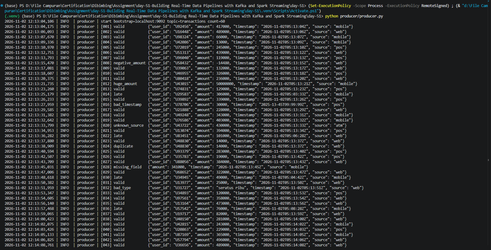
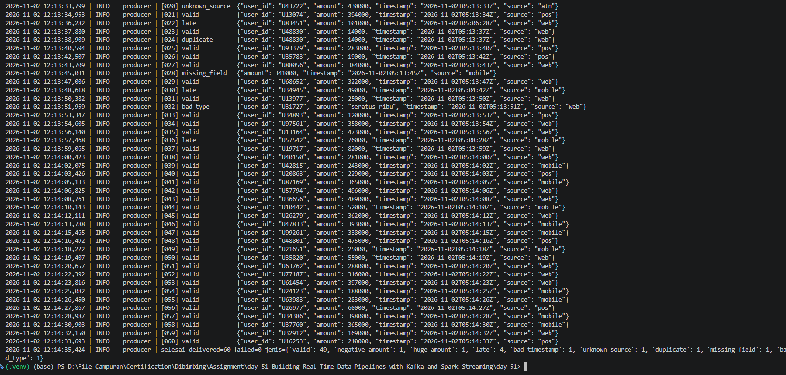
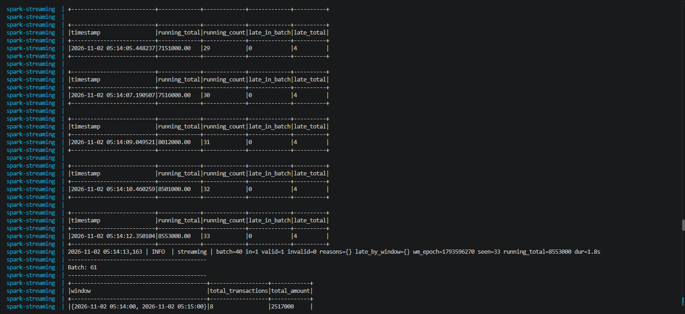
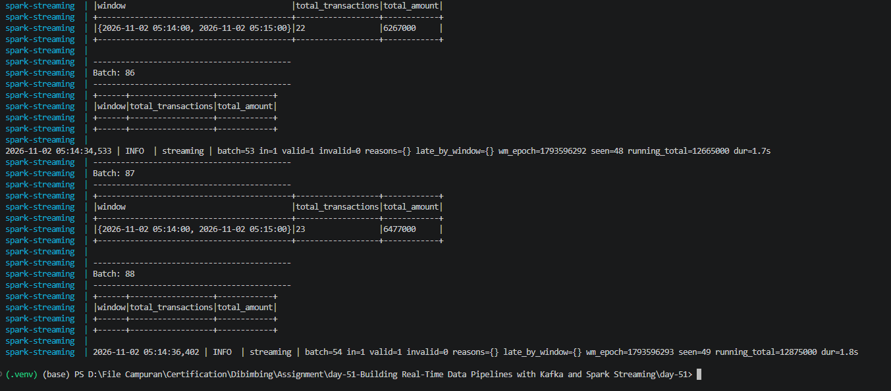
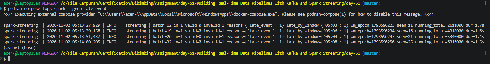
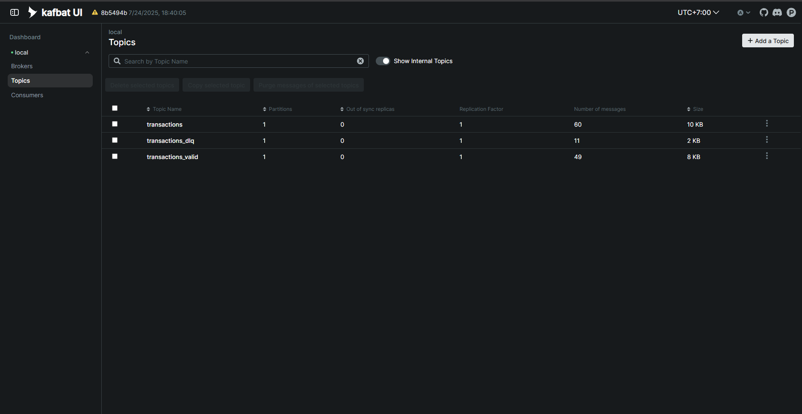
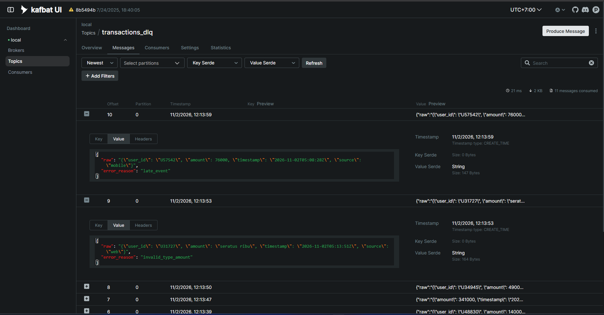

# Streaming for Data Pipeline — Kafka + Spark Structured Streaming

🇮🇩 [Bahasa Indonesia](README.md) · 🇬🇧 English

Real-time transaction pipeline: producer → Kafka `transactions` → PySpark (validation, DLQ, watermark, tumbling window) → `transactions_valid` / `transactions_dlq`.

```
[host] producer.py ──► transactions ──► [docker] Query A ──┬─► transactions_valid ──► Query B (1-minute window)
                                           5 validations,  └─► transactions_dlq
                                           late, duplicate,
                                           running_total (console)
```

Kafka, Kafbat UI, and Spark run in Docker. The producer runs on the host (Python venv) via `localhost:9092`.

## Project Structure
```
.
├── docker-compose.yml           # kafka + kafka-init (creates topics) + kafbat-ui + spark
├── .env.example                 # configuration template (committed)
├── .env                         # local configuration (gitignored)
├── README.md                    # Indonesian
├── README.en.md                 # English
├── pytest.ini
├── requirements-dev.txt         # dependencies for running tests on the host
├── producer/
│   ├── producer.py              # event producer (runs on host)
│   └── requirements.txt
├── streaming/
│   ├── spark_streaming_job.py   # entry point: Kafka I/O, per-batch logic, queries A & B
│   ├── validation.py            # validation rules, Reason, PipelineState
│   ├── config.py                # Settings from environment
│   ├── Dockerfile               # python 3.11 + JRE 17 + pyspark 3.5.3
│   └── requirements.txt
├── tests/                       # pytest: validation, late, duplicate, routing, producer
└── docs/                        # screenshots
```

## Assignment Requirements Mapping
| Requirement | Implementation |
|---|---|
| JSON producer `{user_id, amount, timestamp, source}`, one event every 1–2 s | `producer/producer.py` → `send_events`, pause `uniform(1, 2)` |
| ≥ 3 invalid events (negative/huge amount, timestamp, source, duplicate) | 7 invalid: negative, huge, malformed timestamp, source `atm`, duplicate, missing field, wrong type |
| ≥ 3 late events | 4 late events (2–7 minutes past the watermark) |
| Publish to topic `transactions` | `TOPIC_RAW` |
| Read Kafka + deserialize JSON with a defined schema | `validation.SCHEMA` + `from_json` |
| 5 validations: mandatory, type, range 1–10,000,000, source, duplicate (`user_id`+`timestamp`) | `validation.py`: `_stateless_reason` (1–4), `flag_late_and_duplicates` (5) |
| Columns `is_valid`, `error_reason` | built in `flag_late_and_duplicates` |
| Valid → `transactions_valid`, invalid → `transactions_dlq` | `spark_streaming_job.publish` |
| `.withWatermark("event_time", "3 minutes")` | `build_validation_query` and `build_window_query` |
| Events later than 3 minutes are invalid → DLQ | reason `late_event` |
| 1-minute tumbling window, transaction total per window | `build_window_query`: `total_transactions`, `total_amount` |
| Late events detected | per-batch log `late_by_window`, console columns `late_in_batch`/`late_total`, DLQ `late_event` |
| `foreachBatch` output with columns `timestamp`, `running_total` | `show_running_total` |
| Layout `/producer/producer.py`, `/streaming/spark_streaming_job.py`, `README.md` | matches |

## Prerequisites
- Docker + Docker Compose v2
- Python 3.10–3.13 for the producer. `confluent-kafka` 2.6.1 wheels exist for Windows and Linux (all those versions) and macOS Apple Silicon (macOS 13+); Intel Macs on Python 3.13 have no wheel — use Python 3.12. Avoid Python 3.14+.
- For tests: Python 3.10–3.12 (PySpark 3.5 does not officially support 3.13)
- Java 11/17 only if you run the tests on the host

> **Docker or Podman**: every `docker compose ...` command can be replaced with `podman compose ...` (tried with Podman + the docker-compose provider).

## Producer Setup (virtual environment)
```bash
# Linux / macOS
python3 -m venv .venv
source .venv/bin/activate

# Windows (PowerShell)
python -m venv .venv
.venv\Scripts\Activate.ps1

pip install -r producer/requirements.txt
```
Leave the venv with `deactivate`.

## Configuration (.env)
```bash
cp .env.example .env     # Windows: copy .env.example .env
```
All parameters live in `.env` and are read by Docker Compose, the Spark container, and the producer.

| Variable | Default | Description |
|---|---|---|
| `LOG_LEVEL` | `INFO` | log level for producer & Spark job (`DEBUG` also logs the offset of every delivered message) |
| `KAFKA_IMAGE` | `apache/kafka:3.8.1` | broker image |
| `KAFKA_HOST_PORT` | `9092` | Kafka port on the host |
| `KAFKA_BOOTSTRAP_HOST` | `localhost:9092` | address for the producer (port must match `KAFKA_HOST_PORT`) |
| `KAFKA_BOOTSTRAP_INTERNAL` | `kafka:29092` | address for Spark (container-to-container), do not change |
| `KAFBAT_IMAGE` | `ghcr.io/kafbat/kafka-ui:v1.3.0` | monitoring UI image |
| `KAFBAT_UI_PORT` | `8080` | Kafbat UI port on the host |
| `TOPIC_RAW` / `TOPIC_VALID` / `TOPIC_DLQ` | `transactions` / `transactions_valid` / `transactions_dlq` | topic names |
| `WATERMARK_MINUTES` | `3` | maximum event lateness |
| `WINDOW_MINUTES` | `1` | tumbling window size |
| `AMOUNT_MIN` / `AMOUNT_MAX` | `1` / `10000000` | valid amount range |
| `VALID_SOURCES` | `mobile,web,pos` | accepted sources |
| `PRODUCER_COUNT` | `60` | number of events the producer sends |

After editing `.env`, run `docker compose up -d --build` again so Spark picks up the new values.

## How to Run
**1. Start Kafka + Spark** (first build takes ~3–5 minutes; the Kafka connector jar is downloaded once, then cached)
```bash
docker compose up -d --build
docker compose logs -f spark
```
Wait for `>>> STREAMING STARTED`. Spark uses `startingOffsets=latest`, so start the producer **after** that message appears.

**2. Run the producer** (new terminal, venv active)
```bash
python producer/producer.py            # default 60 events, ~90 seconds
python producer/producer.py --count 40 # optional
```

**3. Inspect the results**

Kafbat UI: **http://localhost:8080** → cluster `local` → *Topics* → pick `transactions`, `transactions_valid`, `transactions_dlq` → *Messages* tab. Good for the valid/DLQ topic screenshots.

Or via CLI / logs:
```bash
docker compose logs -f spark           # console: running_total + 1-minute window

docker compose exec kafka /opt/kafka/bin/kafka-console-consumer.sh \
  --bootstrap-server kafka:29092 --topic transactions_valid --from-beginning
docker compose exec kafka /opt/kafka/bin/kafka-console-consumer.sh \
  --bootstrap-server kafka:29092 --topic transactions_dlq --from-beginning
```

**4. Re-run from a clean state** (dedup/watermark state lives in container memory)
```bash
docker compose down -v
docker compose up -d --build
```

## Running the Tests
```bash
pip install -r requirements-dev.txt     # inside the venv
pytest -q                                # ~45 s (starts a local Spark)
```
Tests do not need Kafka: validation runs on static DataFrames and `write_kafka` is mocked. Coverage: every validation rule (including range boundaries), duplicates within and across batches, late events around the 3-minute boundary, state pruning, valid/DLQ routing with `running_total`, and the producer's event format and schedule.

## Producer
Sends one event every 1–2 seconds. Of 60 events: **7 invalid + 4 late**.

| Event # | Kind | Reason in DLQ |
|---|---|---|
| 8 | negative amount | `amount_out_of_range` |
| 12 | amount 50,000,000 | `amount_out_of_range` |
| 14, 22, 30, 36 | late (2–7 minutes past the watermark) | `late_event` |
| 16 | invalid timestamp | `invalid_type_timestamp` |
| 20 | source `atm` | `invalid_source` |
| 24 | duplicate (same user_id + timestamp) | `duplicate_event` |
| 28 | `user_id` field missing | `missing_field` |
| 32 | amount `"seratus ribu"` (Indonesian for "one hundred thousand", i.e. a non-numeric string) | `invalid_type_amount` |

## Streaming Job
**Query A** (`foreachBatch`)
1. Read `transactions`, parse JSON with a defined schema (all fields are read as strings so type validation is explicit).
2. 5 validations → columns `is_valid`, `error_reason`:
   mandatory fields · type · amount range (1–10,000,000) · source (`mobile`/`web`/`pos`) · duplicate (`user_id`+`timestamp`).
3. Later than `WATERMARK_MINUTES` (default 3 minutes) → invalid (`late_event`).
4. Valid → `transactions_valid`, invalid → `transactions_dlq` (`{raw, error_reason}`).
5. Console: `timestamp`, `running_total` (cumulative valid amount), plus `running_count`, `late_in_batch`, `late_total`.

**Query B**: reads `transactions_valid`, `.withWatermark("event_time", "3 minutes")`, 1-minute tumbling window, computes `total_transactions` and `total_amount` (output mode `update`).

### Design notes
- Spark's watermark only acts on stateful operators (Query B) and drops late data **silently**. To detect late events and route them to the DLQ, Query A tracks its own watermark (max valid event_time of previous batches − 3 minutes, same semantics as Spark) in `PipelineState`.
- Dedup and watermark state live in the driver (single instance) and are pruned automatically once older than 3 minutes. State is not persisted across restarts → use `docker compose down -v` for a clean re-run.
- Dual Kafka listeners: `kafka:29092` for container-to-container traffic, `localhost:9092` for the host.

## Logging
Format: `time | level | module | message`.

- **Producer**: one line per event (`[008] negative_amount {...}`), delivery errors, and a final summary (`delivered`, `failed`, count per event kind).
- **Spark job**: configuration at startup and one summary line per batch:
  `batch=7 in=3 valid=1 invalid=2 reasons={'late_event': 1, 'duplicate_event': 1} late_by_window={'09:12': 1} wm_epoch=... seen=14 running_total=... dur=1.2s`
  If a batch fails, `batch=N GAGAL diproses` (Indonesian for "failed to process") is logged with the stack trace before the error is re-raised.
- The `running_total` table and the 1-minute window still print to the console, as the assignment requires.

```bash
docker compose logs -f spark | grep "batch="    # batch summaries only
```

### Saving logs to a file
```powershell
# Windows PowerShell
mkdir logs
docker compose logs spark --no-color | Out-File logs\spark.log -Encoding utf8
python producer/producer.py 2>&1 | Tee-Object logs\producer.log
```
```bash
# Linux / macOS
mkdir -p logs
docker compose logs spark --no-color > logs/spark.log
python producer/producer.py 2>&1 | tee logs/producer.log
```
The `logs/` folder is already in `.gitignore`.

## Troubleshooting
| Symptom | Cause / fix |
|---|---|
| Producer runs but Spark shows no batches | The producer was started before `STREAMING STARTED`. Run the producer again. |
| `NoBrokersAvailable` / `Connection refused` in the producer | Kafka is not healthy yet: `docker compose ps`, wait for `healthy`. |
| Spark cannot download the jar | Check the container's internet access; retry `docker compose up -d`. |
| `running_total` table missing from `logs spark` | Python stdout was buffered. Fixed (`PYTHONUNBUFFERED=1` + flush); run `docker compose up -d --build` to use the new image. Find it with `docker compose logs spark \| grep -A4 running_total`. |
| Port 8080 in use | Change `KAFBAT_UI_PORT` in `.env`. |
| Port 9092 in use | Change `KAFKA_HOST_PORT` and `KAFKA_BOOTSTRAP_HOST` in `.env`. |
| `pip install` fails building `confluent-kafka` (`WinError 206`, "Failed building wheel") | Older versions have no wheel for your Python, so pip compiles from source. Use the version in `producer/requirements.txt` (2.6.1) and upgrade pip: `python -m pip install -U pip`. |
| Compose warning `variable is not set` | `.env` not created yet: `cp .env.example .env`. |

## Test Results
One full run: 60 events, clean pipeline (`down -v` beforehand).

| Component | Result |
|---|---|
| Producer | `delivered=60 failed=0`; 49 valid, 7 invalid (negative, huge, timestamp, source, duplicate, missing field, wrong type), 4 late |
| Topic `transactions` | 60 messages |
| Topic `transactions_valid` | 49 messages |
| Topic `transactions_dlq` | 11 messages = 7 invalid + 4 late (49 + 11 = 60, nothing lost) |
| Late events detected | 4 batches with `reasons={'late_event': 1}`, `late_by_window` = `05:03`, `05:04`, `05:06`, `05:08` (UTC) |
| Final `running_total` | 12,875,000 (log `batch=54`) |
| 1-minute window | `05:14–05:15` → 23 transactions, total_amount 6,477,000 |

## Screenshots
**Kafka producer** — start of the run through event 43, then event 20 through the final summary (`delivered=60 failed=0`, count per event kind).




**Streaming console** — `foreachBatch` output with the required columns `timestamp` (when Spark produced the output) and `running_total` (cumulative valid amount), plus `running_count`, `late_in_batch`, `late_total`. Tables and log lines come from two streams (stdout and stderr), so they may appear grouped in `logs`.



The 1-minute tumbling window table (`total_transactions`, `total_amount`) and per-batch summaries:



Late events detected (`docker compose logs spark | grep late_event`): 4 batches, each with `reasons={'late_event': 1}` and `late_by_window`.



**Valid & DLQ topics (Kafbat UI)** — message count per topic, and DLQ contents with `error_reason`.




## Repository Link
<https://github.com/ivansurachman/realtime-data-streaming-kafka-spark>
