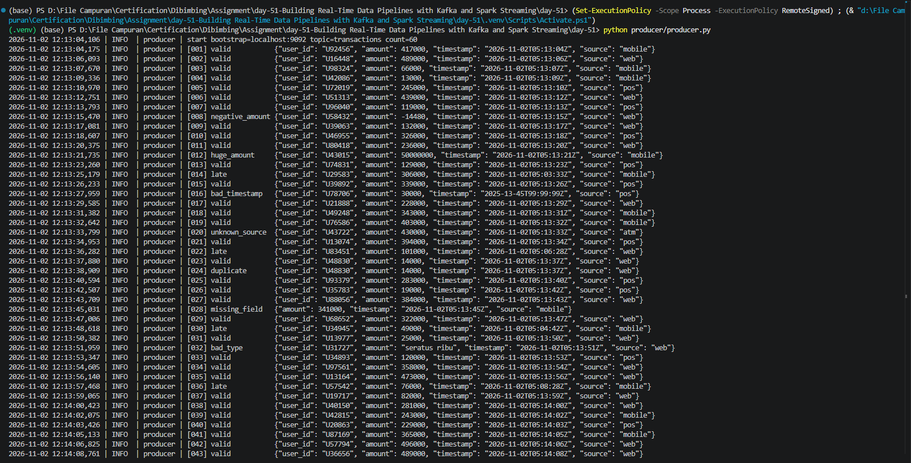
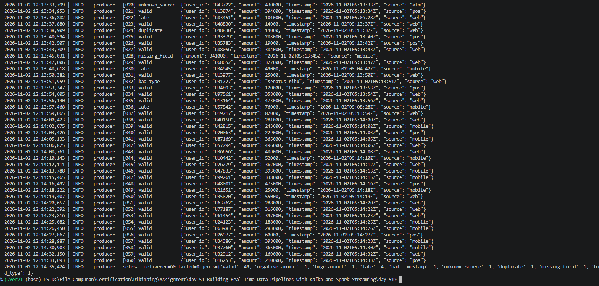
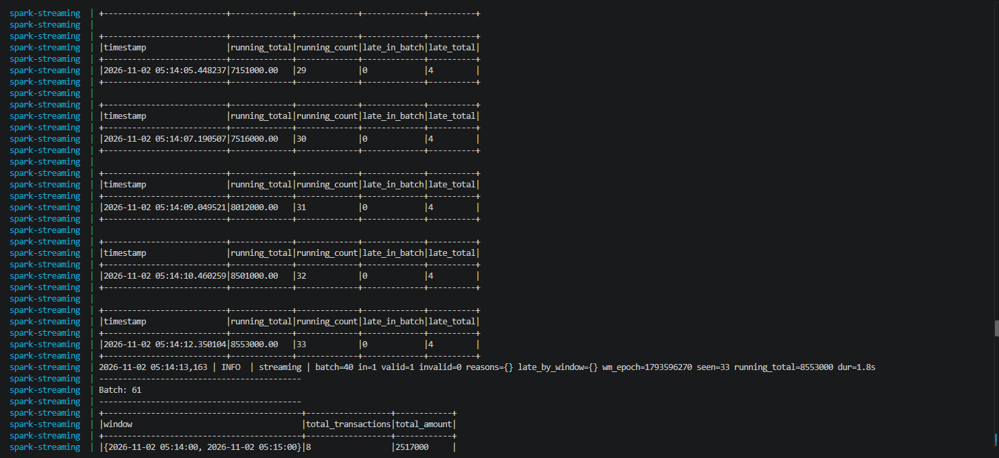
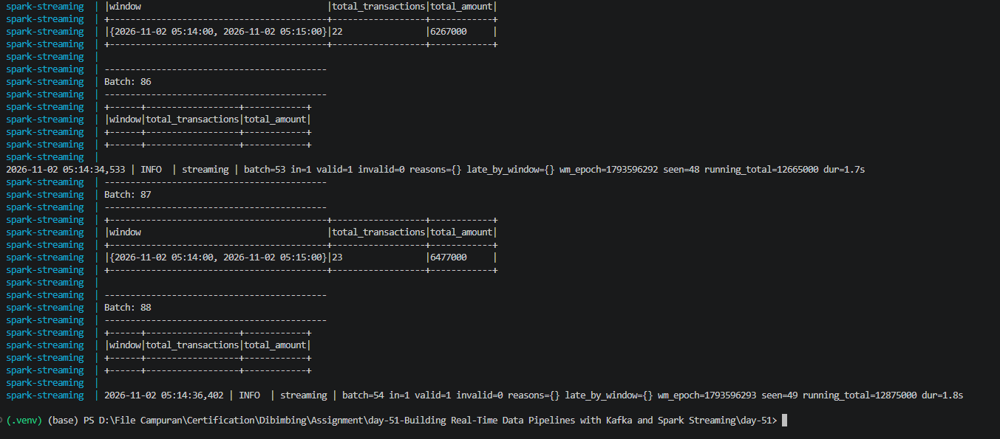
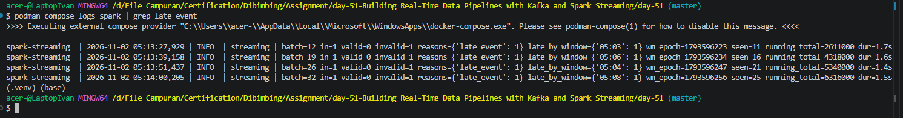
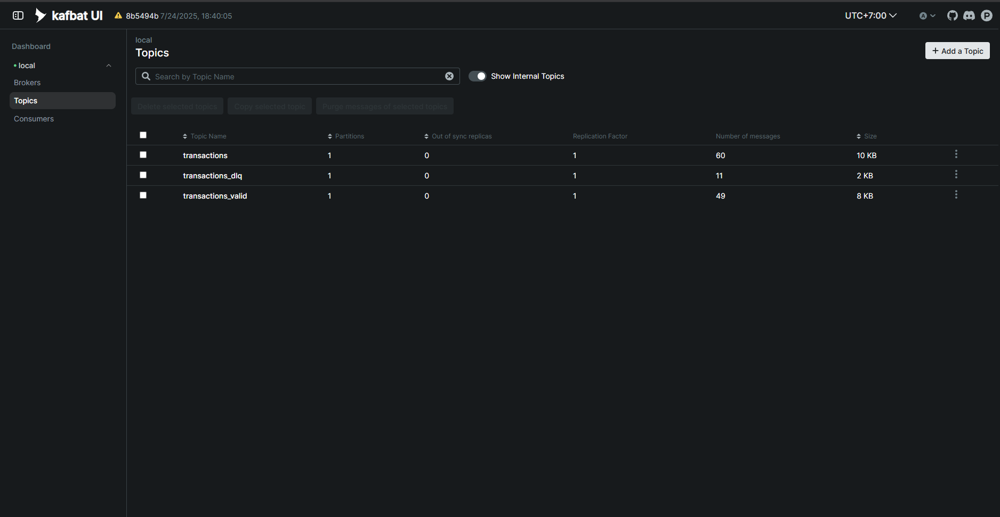
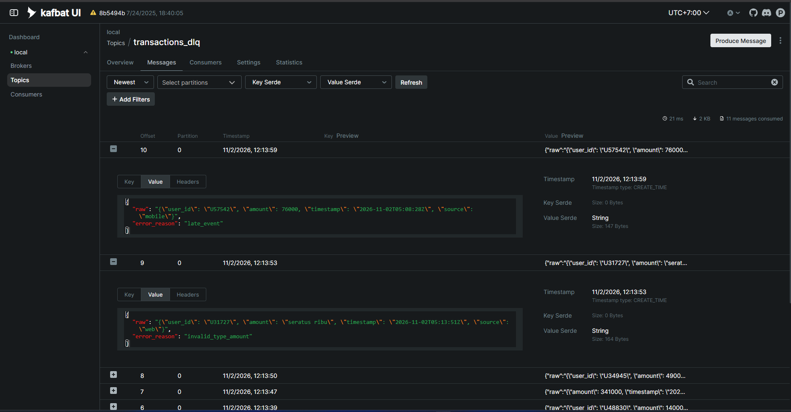

# Streaming for Data Pipeline — Kafka + Spark Structured Streaming

🇮🇩 Bahasa Indonesia · 🇬🇧 [English](README.en.md)

Pipeline transaksi real-time: producer → Kafka `transactions` → PySpark (validasi, DLQ, watermark, tumbling window) → `transactions_valid` / `transactions_dlq`.

```
[host] producer.py ──► transactions ──► [docker] Query A ──┬─► transactions_valid ──► Query B (window 1 menit)
                                           5 validasi,     └─► transactions_dlq
                                           late, duplicate,
                                           running_total (console)
```

Kafka, Kafbat UI, dan Spark berjalan di Docker. Producer berjalan di host (Python venv) lewat `localhost:9092`.

## Struktur Folder
```
.
├── docker-compose.yml           # kafka + kafka-init (buat topic) + kafbat-ui + spark
├── .env.example                 # template konfigurasi (commit)
├── .env                         # konfigurasi lokal (di-gitignore)
├── README.md                    # Bahasa Indonesia
├── README.en.md                 # English
├── pytest.ini
├── requirements-dev.txt         # dependensi untuk menjalankan tes di host
├── producer/
│   ├── producer.py              # event producer (jalan di host)
│   └── requirements.txt
├── streaming/
│   ├── spark_streaming_job.py   # entry point: Kafka I/O, per-batch, query A & B
│   ├── validation.py            # aturan validasi, Reason, PipelineState
│   ├── config.py                # Settings dari environment
│   ├── Dockerfile               # python 3.11 + JRE 17 + pyspark 3.5.3
│   └── requirements.txt
├── tests/                       # pytest: validasi, late, duplicate, routing, producer
└── docs/                        # screenshot
```

## Kesesuaian dengan Kriteria Tugas
| Kriteria | Implementasi |
|---|---|
| Producer JSON `{user_id, amount, timestamp, source}`, 1–2 detik/event | `producer/producer.py` → `send_events`, jeda `uniform(1, 2)` |
| ≥ 3 event invalid (amount negatif/besar, timestamp, source, duplicate) | 7 invalid: negatif, besar, timestamp rusak, source `atm`, duplicate, field hilang, tipe salah |
| ≥ 3 late event | 4 late event (2–7 menit melewati watermark) |
| Publish ke topic `transactions` | `TOPIC_RAW` |
| Baca Kafka + deserialize JSON dengan schema terdefinisi | `validation.SCHEMA` + `from_json` |
| 5 validasi: mandatory, type, range 1–10.000.000, source, duplicate (`user_id`+`timestamp`) | `validation.py`: `_stateless_reason` (1–4), `flag_late_and_duplicates` (5) |
| Kolom `is_valid`, `error_reason` | dibentuk di `flag_late_and_duplicates` |
| Valid → `transactions_valid`, invalid → `transactions_dlq` | `spark_streaming_job.publish` |
| `.withWatermark("event_time", "3 minutes")` | `build_validation_query` dan `build_window_query` |
| Late > 3 menit dianggap invalid → DLQ | alasan `late_event` |
| Tumbling window 1 menit, total transaksi per window | `build_window_query`: `total_transactions`, `total_amount` |
| Late event terdeteksi | log per batch `late_by_window`, kolom console `late_in_batch`/`late_total`, DLQ `late_event` |
| Output `foreachBatch` dengan kolom `timestamp`, `running_total` | `show_running_total` |
| Struktur `/producer/producer.py`, `/streaming/spark_streaming_job.py`, `README.md` | sesuai |

## Prasyarat
- Docker + Docker Compose v2
- Python 3.10–3.13 untuk producer. Wheel `confluent-kafka` 2.6.1 tersedia untuk Windows dan Linux (semua versi tsb) serta macOS Apple Silicon (macOS 13+); Mac Intel dengan Python 3.13 belum punya wheel, pakai Python 3.12. Hindari Python 3.14+.
- Untuk tes: Python 3.10–3.12 (PySpark 3.5 belum mendukung 3.13 secara resmi)
- Java 11/17 hanya jika menjalankan tes di host

> **Docker atau Podman**: semua perintah `docker compose ...` bisa diganti `podman compose ...` (sudah dicoba dengan Podman + provider docker-compose).

## Setup Producer (virtual environment)
```bash
# Linux / macOS
python3 -m venv .venv
source .venv/bin/activate

# Windows (PowerShell)
python -m venv .venv
.venv\Scripts\Activate.ps1

pip install -r producer/requirements.txt
```
Keluar venv: `deactivate`.

## Konfigurasi (.env)
```bash
cp .env.example .env     # Windows: copy .env.example .env
```
Semua parameter ada di `.env` dan dibaca oleh Docker Compose, container Spark, dan producer.

| Variabel | Default | Keterangan |
|---|---|---|
| `LOG_LEVEL` | `INFO` | level log producer & Spark job (`DEBUG` menampilkan offset tiap pesan terkirim) |
| `KAFKA_IMAGE` | `apache/kafka:3.8.1` | image broker |
| `KAFKA_HOST_PORT` | `9092` | port Kafka di host |
| `KAFKA_BOOTSTRAP_HOST` | `localhost:9092` | alamat untuk producer (port harus sama dgn `KAFKA_HOST_PORT`) |
| `KAFKA_BOOTSTRAP_INTERNAL` | `kafka:29092` | alamat untuk Spark (antar container), jangan diubah |
| `KAFBAT_IMAGE` | `ghcr.io/kafbat/kafka-ui:v1.3.0` | image UI monitoring |
| `KAFBAT_UI_PORT` | `8080` | port Kafbat UI di host |
| `TOPIC_RAW` / `TOPIC_VALID` / `TOPIC_DLQ` | `transactions` / `transactions_valid` / `transactions_dlq` | nama topic |
| `WATERMARK_MINUTES` | `3` | batas keterlambatan event |
| `WINDOW_MINUTES` | `1` | ukuran tumbling window |
| `AMOUNT_MIN` / `AMOUNT_MAX` | `1` / `10000000` | range amount valid |
| `VALID_SOURCES` | `mobile,web,pos` | source yang diterima |
| `PRODUCER_COUNT` | `60` | jumlah event producer |

Ubah `.env` lalu `docker compose up -d --build` ulang agar Spark membaca nilai baru.

## Cara Menjalankan
**1. Start Kafka + Spark** (build pertama ±3–5 menit; jar Kafka konektor diunduh sekali lalu di-cache)
```bash
docker compose up -d --build
docker compose logs -f spark
```
Tunggu sampai muncul `>>> STREAMING STARTED`. Spark memakai `startingOffsets=latest`, jadi producer harus dijalankan **setelah** pesan itu muncul.

**2. Jalankan producer** (terminal baru, venv aktif)
```bash
python producer/producer.py            # default 60 event, ±90 detik
python producer/producer.py --count 40 # opsional
```

**3. Lihat hasil**

Kafbat UI: **http://localhost:8080** → cluster `local` → *Topics* → pilih `transactions`, `transactions_valid`, `transactions_dlq` → tab *Messages*. Cocok untuk screenshot topik valid & DLQ.

Atau lewat CLI / log:
```bash
docker compose logs -f spark           # console: running_total + window 1 menit

docker compose exec kafka /opt/kafka/bin/kafka-console-consumer.sh \
  --bootstrap-server kafka:29092 --topic transactions_valid --from-beginning
docker compose exec kafka /opt/kafka/bin/kafka-console-consumer.sh \
  --bootstrap-server kafka:29092 --topic transactions_dlq --from-beginning
```

**4. Run ulang dari bersih** (state dedup/watermark ada di memori container)
```bash
docker compose down -v
docker compose up -d --build
```

## Menjalankan Tes
```bash
pip install -r requirements-dev.txt     # di dalam venv
pytest -q                                # ±45 detik (start Spark lokal)
```
Tes tidak membutuhkan Kafka: validasi dijalankan pada DataFrame statis dan `write_kafka` di-mock. Cakupan: tiap aturan validasi (termasuk batas range), duplikat dalam batch dan antar batch, late event di sekitar batas 3 menit, pembersihan state, routing valid/DLQ beserta `running_total`, serta format dan jadwal event producer.

## Producer
Kirim 1 event / 1–2 detik. Dari 60 event: **7 invalid + 4 late**.

| Event ke | Jenis | Alasan di DLQ |
|---|---|---|
| 8 | amount negatif | `amount_out_of_range` |
| 12 | amount 50.000.000 | `amount_out_of_range` |
| 14, 22, 30, 36 | late (2–7 menit melewati watermark) | `late_event` |
| 16 | timestamp tidak valid | `invalid_type_timestamp` |
| 20 | source `atm` | `invalid_source` |
| 24 | duplicate (user_id + timestamp sama) | `duplicate_event` |
| 28 | field `user_id` hilang | `missing_field` |
| 32 | amount `"seratus ribu"` | `invalid_type_amount` |

## Streaming Job
**Query A** (`foreachBatch`)
1. Baca `transactions`, parse JSON dengan schema terdefinisi (semua field string agar type validation eksplisit).
2. 5 validasi → kolom `is_valid`, `error_reason`:
   mandatory field · type · range amount (1–10.000.000) · source (`mobile`/`web`/`pos`) · duplicate (`user_id`+`timestamp`).
3. Late > `WATERMARK_MINUTES` (default 3 menit) → invalid (`late_event`).
4. Valid → `transactions_valid`, invalid → `transactions_dlq` (`{raw, error_reason}`).
5. Console: `timestamp`, `running_total` (kumulatif amount valid), plus `running_count`, `late_in_batch`, `late_total`.

**Query B**: baca `transactions_valid`, `.withWatermark("event_time", "3 minutes")`, tumbling window 1 menit, hitung `total_transactions` dan `total_amount` (output mode `update`).

### Catatan desain
- Watermark Spark hanya bekerja di operasi stateful (Query B) dan men-drop late data **tanpa jejak**. Agar late event bisa dideteksi dan dikirim ke DLQ, Query A menghitung watermark sendiri (max event_time valid batch sebelumnya − 3 menit, semantik sama dengan Spark) di `PipelineState`.
- State dedup dan watermark disimpan di driver (single instance), dipangkas otomatis setelah lewat 3 menit. Tidak persisten antar restart → gunakan `docker compose down -v` untuk run ulang.
- Listener Kafka ganda: `kafka:29092` untuk antar container, `localhost:9092` untuk host.

## Logging
Format: `waktu | level | modul | pesan`.

- **Producer**: satu baris per event (`[008] negative_amount {...}`), error delivery, dan ringkasan akhir (`delivered`, `failed`, jumlah per jenis event).
- **Spark job**: konfigurasi saat start dan satu baris ringkasan per batch:
  `batch=7 in=3 valid=1 invalid=2 reasons={'late_event': 1, 'duplicate_event': 1} late_by_window={'09:12': 1} wm_epoch=... seen=14 running_total=... dur=1.2s`
  Kalau batch gagal, `batch=N GAGAL diproses` dicatat beserta stack trace sebelum error diteruskan.
- Tabel `running_total` dan window 1 menit tetap tampil di console sesuai ketentuan tugas.

```bash
docker compose logs -f spark | grep "batch="    # ringkasan per batch saja
```

### Menyimpan log ke file
```powershell
# Windows PowerShell
mkdir logs
docker compose logs spark --no-color | Out-File logs\spark.log -Encoding utf8
python producer/producer.py 2>&1 | Tee-Object logs\producer.log
```
```bash
# Linux / macOS
mkdir -p logs
docker compose logs spark --no-color > logs/spark.log
python producer/producer.py 2>&1 | tee logs/producer.log
```
Folder `logs/` sudah di `.gitignore`.

## Troubleshooting
| Gejala | Penyebab / solusi |
|---|---|
| Producer jalan tapi Spark tidak menampilkan batch | Producer dijalankan sebelum `STREAMING STARTED`. Jalankan ulang producer. |
| `NoBrokersAvailable` / `Connection refused` di producer | Kafka belum healthy: `docker compose ps`, tunggu status `healthy`. |
| Spark gagal download jar | Cek internet container; ulangi `docker compose up -d`. |
| Tabel `running_total` tidak muncul di `logs spark` | Stdout Python ter-buffer. Sudah diperbaiki (`PYTHONUNBUFFERED=1` + flush); jalankan `docker compose up -d --build` agar image baru dipakai. Cari dengan `docker compose logs spark \| grep -A4 running_total`. |
| Port 8080 terpakai | Ubah `KAFBAT_UI_PORT` di `.env`. |
| Port 9092 terpakai | Ubah `KAFKA_HOST_PORT` dan `KAFKA_BOOTSTRAP_HOST` di `.env`. |
| `pip install` gagal build `confluent-kafka` (`WinError 206`, "Failed building wheel") | Versi lama tidak punya wheel untuk Python-mu sehingga pip compile dari source. Pakai versi di `producer/requirements.txt` (2.6.1) dan upgrade pip: `python -m pip install -U pip`. |
| Compose warning `variable is not set` | `.env` belum dibuat: `cp .env.example .env`. |

## Hasil Uji
Satu run penuh: 60 event, pipeline bersih (`down -v` sebelum run).

| Komponen | Hasil |
|---|---|
| Producer | `delivered=60 failed=0`; 49 valid, 7 invalid (negatif, besar, timestamp, source, duplicate, field hilang, tipe salah), 4 late |
| Topic `transactions` | 60 pesan |
| Topic `transactions_valid` | 49 pesan |
| Topic `transactions_dlq` | 11 pesan = 7 invalid + 4 late (49 + 11 = 60, tidak ada yang hilang) |
| Late event terdeteksi | 4 batch dengan `reasons={'late_event': 1}`, `late_by_window` = `05:03`, `05:04`, `05:06`, `05:08` (UTC) |
| `running_total` akhir | 12.875.000 (log `batch=54`) |
| Window 1 menit | `05:14–05:15` → 23 transaksi, total_amount 6.477.000 |

## Screenshot
**Kafka producer** — awal run sampai event ke-43, lalu event ke-20 sampai ringkasan akhir (`delivered=60 failed=0`, jumlah per jenis event).




**Streaming console** — output `foreachBatch` dengan kolom wajib `timestamp` (waktu Spark melakukan output) dan `running_total` (kumulatif amount valid), plus `running_count`, `late_in_batch`, `late_total`. Tabel dan baris log berasal dari dua stream (stdout dan stderr), jadi di `logs` bisa tampil berkelompok.



Tabel tumbling window 1 menit (`total_transactions`, `total_amount`) dan ringkasan per batch:



Late event terdeteksi (`docker compose logs spark | grep late_event`): 4 batch, masing-masing `reasons={'late_event': 1}` dan `late_by_window`.



**Topik valid & DLQ (Kafbat UI)** — jumlah pesan per topic, dan isi DLQ dengan `error_reason`.




## Link Repo
<https://github.com/ivansurachman/realtime-data-streaming-kafka-spark>
